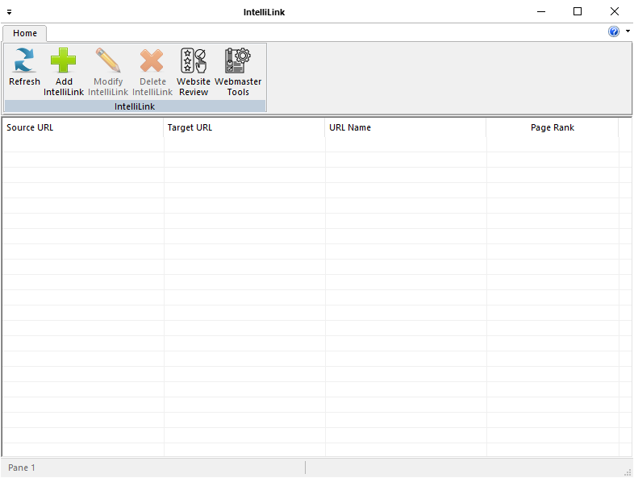

Download:
- [IntelliLinkSetup.msi](https://www.moga.doctor/freeware/IntelliLinkSetup.msi)
- [IntelliLink.zip](https://www.moga.doctor/freeware/IntelliLink.zip)

## Introduction

_IntelliLink_ is a free (as in “free speech” and also as in “free beer”) online link manager. Running in the Microsoft Windows environment, its use is governed by [GNU General Public License v3.0](https://www.gnu.org/licenses/gpl-3.0.html). _IntelliLink_ is written in C++ and uses pure Win32 API and STL which ensures a higher execution speed and smaller program size. By optimizing as many routines as possible without losing user friendliness, _IntelliLink_ is trying to reduce the world carbon dioxide emissions. When using less CPU power, the PC can throttle down and reduce power consumption, resulting in a greener environment. I hope you enjoy _IntelliLink_ as much as I enjoy coding it!

## Getting started

### Install IntelliLink using the installer

- Download the installer
- Run the executable binary and follow the installation flow

The installer will likely require Administrative privileges in order to install _IntelliLink_ (and later, to update _IntelliLink_ or install or update plugins, or anything else that requires writing to the installation directory). If you do not have Administrative privileges, you either need to tell the installer to use a location where you do have write permission (though that may still ask for Administrator privileges), or you may choose not use the installer and instead run a portable edition from a directory where you have write permission.

### Install IntelliLink from zip

These instructions will allow you to run a portable or mini-portable (also called “minimalist”), without requiring administrative privileges.

- Create a new folder somewhere that you have write-permission
- Unzip the content into the new folder
- Run _IntelliLink_ from the new folder

The portable zip edition of _IntelliLink_ can be removed by deleting the directory they came in. If you manually set up file associations or context-menu entries in the OS, it is your responsibility to remove them yourself.

## Application's menu

The _IntelliLink_ menu features the application's most important functions:

- **Refresh**: Refreshes the status of all hyperlinks.
- **Add IntelliLink**: Adds a new hyperlink to the list.
- **Modify IntelliLink**: Modifies the selected hyperlink from the list.
- **Delete IntelliLink**: Deletes the selected hyperlink from the list.
- **Website Review**: Opens [https://www.website-review.ro/](https://www.website-review.ro/) in your web browser.
- **Webmaster Tools**: Opens [https://www.webmaster-tools.ro/](https://www.webmaster-tools.ro/) in your web browser.

## Roadmap

This roadmap outlines where _IntelliLink_ is heading. It brings together the work under way for the next release, the improvements that follow from how _IntelliLink_ works today, and the maintenance work that goes into every release. Items are grouped by horizon rather than by date, and their order may change as feedback arrives or as the libraries _IntelliLink_ builds on evolve, so please treat it as a statement of intent, not a promise. For everything that has already shipped, see the [Release Notes](https://github.com/mihaimoga/IntelliLink/releases).

_Last reviewed: November 2026 (version 1.28 in development)._

### Now (in progress and ongoing)

- **Up-to-date components**: each release picks up the latest Microsoft Edge WebView2 (embedded browser) and genUp4win (automatic updates) and, as new versions are published, TinyXML2 (link storage), Bootstrap (help and release notes pages) and PJ Naughter's MFC components.
- **Update experience**: version 1.28 keeps the _Check for Updates_ dialog open when no new version is found, and exits the application after launching an available installer so that its files can be replaced. It builds on the SHA-256 verification of downloaded installers (version 1.26) and the download progress reporting (version 1.27).
- **Stability, security and performance**: bug fixes, security updates and performance tuning continue alongside new features.

### Next (planned, next in line)

- **Faster, non-blocking Refresh**: today the links are checked one after another on the main thread, and the source page of every link is downloaded twice per check (once to fill the Status column and once to choose the tray icon). _IntelliLink_ runs this check at startup, every 10 minutes and whenever you choose Refresh. The plan is to download each page only once, run the checks in the background so that the window stays responsive, and report progress in the status bar.
- **Clearer link status**: the Status column only shows Verified, Error or Unknown. The plan is to also show why a check failed (the page could not be downloaded, or the link was not found on it) and when the link was last checked.

### Later (planned, larger efforts)

- **More reliable link detection**: today _IntelliLink_ looks for an `href` attribute in double quotes that equals the target URL, followed by the exact anchor text on the same line. Reading the page as real HTML would also cover single-quoted attributes, anchors that span several lines or contain other markup, and HTML entities such as `&amp;`.
- **Change notifications**: a tray balloon when a link changes from Verified to Error, instead of only switching the tray icon from happy to sad. The tray component used by _IntelliLink_ already supports balloons.

Clearer status and change notifications need the same groundwork as the faster Refresh (a background check that returns a detailed result), which is why the faster Refresh comes first.

### Under consideration (ideas, not yet committed)

- **Page Rank column**: the value is read from `ConfigLink.xml`, but the Add and Modify dialogs have no field for it and new links start at 0. It could become editable, or be replaced by something that can be measured, such as the response time of the source page.
- **Configurable refresh interval**: the 10-minute interval is fixed in the program. A setting could change it, or turn the automatic check off and leave only the manual Refresh.
- **Import and export**: exchange the list of links with other tools, for example as CSV, instead of editing `ConfigLink.xml` by hand.
- **Fully portable edition**: the zip edition still keeps the link list (`ConfigLink.xml`) in the user profile folder and the window layout in the registry. An option to keep both next to the executable would make it fully portable.
- **Link attributes**: show the `rel` attribute of a link (for example `nofollow`, `sponsored` or `ugc`) next to its status.
- **Localized user interface**: genUp4win already supports several languages, but the _IntelliLink_ user interface is English only.
- **Native ARM64 and high-DPI support**: a native ARM64 build for Windows on Arm devices (_IntelliLink_ is currently built for x86 and x64) and Per-Monitor V2 DPI awareness for a sharper interface on high-DPI and mixed-DPI displays.
- **Continuous integration and automated tests**: build all four configurations (Debug and Release, x86 and x64) on every push and pull request, and test the link check without running the application. Neither exists in the repository today.

### Help shape the roadmap

Want to see something sooner, or have an idea that is not listed here? [Open an issue](https://github.com/mihaimoga/IntelliLink/issues) or start a conversation in [Discussions](https://github.com/mihaimoga/IntelliLink/discussions). Contributions are welcome as well: any item above can be picked up through a pull request, as described in the next section. Please note that a pull request for an enhancement is merged only after its issue has been approved by a project administrator and carries the `Accepted` label, so it is best to open an issue and discuss the idea before you start.

## Create and Submit your Pull Request

As noted in the [Contributing Rules](https://github.com/mihaimoga/IntelliLink/blob/main/CONTRIBUTING.md) for _IntelliLink_, all Pull Requests need to be attached to a issue on GitHub. So the first step is to create an issue which requests that the functionality be improved (if it was already there) or added (if it was not yet there); in your issue, be sure to explain that you have the functionality definition ready, and will be submitting a Pull Request. The second step is to use the GitHub interface to create the Pull Request from your fork into the main repository. The final step is to wait for and respond to feedback from the developers as needed, until such time as your PR is accepted or rejected.

## Acknowledges

This open source project uses the following libraries:

- Stefan-Mihai MOGA's [genUp4win](https://github.com/mihaimoga/genUp4win)
- PJ Naughter's [CHLinkCtrl](https://www.naughter.com/hlinkctrl.html)
- PJ Naughter's [CInstanceChecker](https://www.naughter.com/sinstance.html)
- Lee Thomason's [TinyXML2](https://github.com/leethomason/tinyxml2)
- PJ Naughter's [CTrayNotifyIcon](https://www.naughter.com/ntray.html)
- PJ Naughter's [CVersionInfo](https://www.naughter.com/versioninfo.html)
